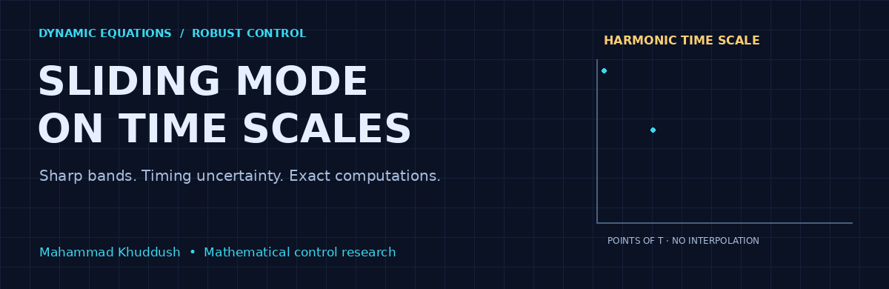
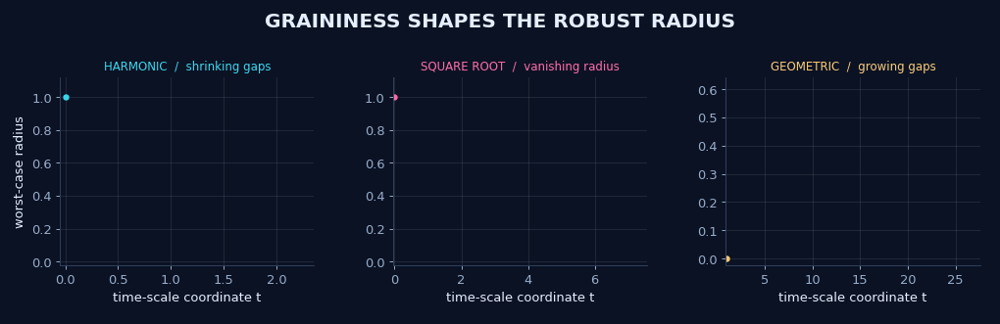
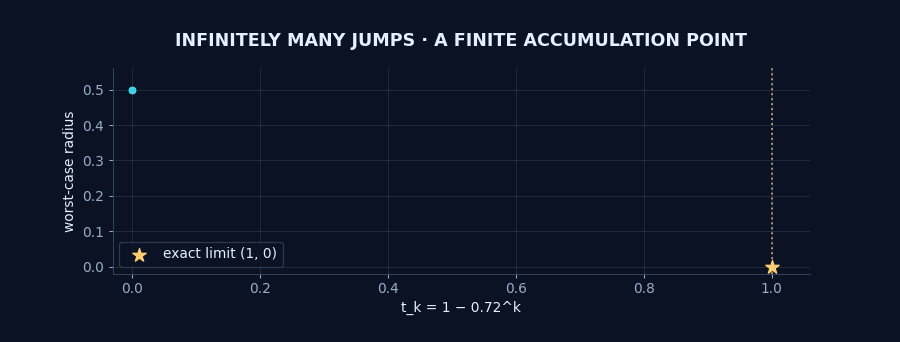
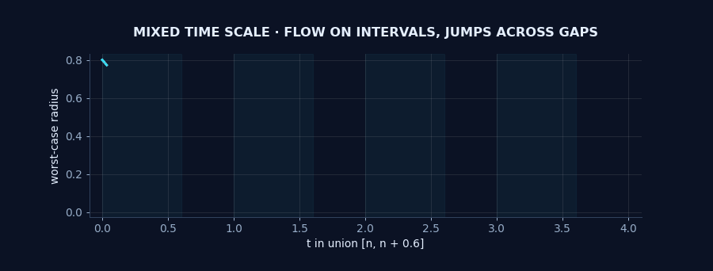
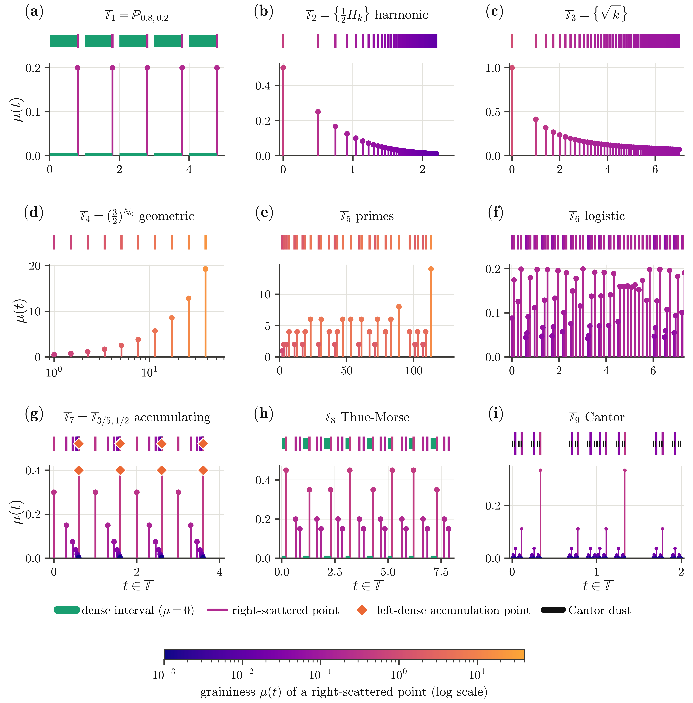

<div align="center">



# 🧭 Sliding Mode Control on Time Scales
### Sharp bands · Timing uncertainty · Exact computations


**[🎬 Motion gallery](#-motion-gallery) · [🧮 Mathematics](#-mathematics) · [🚀 Run locally](#-run-locally) · [🗺️ Repository map](#️-repository-map) · [👤 Author](#-author)**

</div>

Explore how the geometry of a time scale changes robust sliding control. This research companion brings together project code, exact computations and original animations for dense, scattered, mixed and accumulating time scales.

> 💡 **The gaps matter.** Every discrete marker belongs to the time scale. No state curve is drawn across a deleted interval. Animation frames reveal computed states; playback speed is not physical time.

## 🎬 Motion gallery

### 💎 One law, three geometries



| 🔵 Harmonic | 🩷 Square-root | 🟡 Geometric |
| :--- | :--- | :--- |
| Shrinking positive gaps | Graininess tends to zero | Gaps grow without bound |
| Vanishing robust radius | Vanishing robust radius | Growing disturbance injection |
| $t_k=\frac12H_k$ | $t_k=\sqrt{k}$ | $t_k=1.12^k$ |

The first two panels start at radius 1; the geometric panel starts at radius 0. All three use $U=1$ and $D=0.2$. Axes are scaled independently.

### ✨ Infinite updates, finite accumulation



The points $t_k=1-0.72^k$ accumulate at 1. With initial radius $0.5$, $U=1$ and $D=0.2$, the limiting radius is zero. The gold star marks the analytical limit; the animation displays a finite prefix of 42 points.

### 🌊 Dense evolution meets scattered updates



On $\bigcup_{n\ge0}[n,n+0.6]$, the radius decreases on each dense interval and receives a disturbance contribution across each gap. Only the first four cells are displayed. Curves stop at interval endpoints; the gaps remain empty.

<details>
<summary><b>🗺️ Open the nine-time-scale atlas</b></summary>



The atlas is a retained project figure. Its finite displays represent the indicated time scales; they do not turn an accumulating or infinite scale into a finite mathematical object.

</details>

## 🧮 Mathematics

For the scalar sliding channel at a right-scattered point,

$$s^\sigma=s+\mu(v+d),\qquad |v|\le U,\quad |d|\le D.$$

With known positive graininess $h$ and $U>D\ge0$, the exact one-step worst-case radius is

$$F_h(r)=\max\{hD,\;r-h(U-D)\},\qquad r\ge0.$$

The animations apply this recurrence at scattered points. On dense intervals, they use $r(t)=\max\{0,r(t_0)-(U-D)(t-t_0)\}$.

For unrevealed graininess $0<a\le h\le b$, the minimax radius map is

$$F(r)=\begin{cases}bD,&r\le bD,\\\max\left\{\dfrac{(b-a)r+2abD}{a+b},\;r-a(U-D)\right\},&r>bD.\end{cases}$$

See [the visual guide](docs/VISUAL_GUIDE.md) for parameters and interpretation, and [verification notes](docs/VERIFICATION.md) for the scope of the computational checks.

## 🚀 Run locally

Use Python 3.10 or later. From the repository root:

```bash
python -m venv .venv
# Linux / macOS
source .venv/bin/activate
# Windows PowerShell: .venv\Scripts\Activate.ps1
python -m pip install -r requirements.txt
```

**Regenerate the four animations:**

```bash
python Code/animate.py
```

**Run the nine verification and experiment scripts:**

```bash
python Code/run_all.py
```

The verification run creates `Data/` and `Reports/logs/` locally. These generated outputs are ignored by Git. There is no TeX build step or manuscript dependency.

## 🗺️ Repository map

| Path | What you will find |
| :--- | :--- |
| `assets/` | Four original GIFs and the project time-scale atlas |
| `Code/animate.py` | Reproducible animation generator |
| `Code/tsmc/` | Control, time-scale, sampling-design and network routines |
| `Code/scripts/` | Nine verification and experiment scripts |
| `Code/run_all.py` | Ordered verification runner |
| `docs/` | Visual interpretation and verification notes |
| `requirements.txt` | Runtime dependencies |

## 👤 Author

**Dr. Mahammad Khuddush**

🏛️ Department of Mathematics, Vignan’s Institute of Information Technology (Autonomous), Visakhapatnam, India  
🏛️ School of Sciences, Woxsen University, Hyderabad, India

[](https://orcid.org/0000-0002-1236-8334)
[](mailto:khuddush89@gmail.com)

---

<div align="center">

**🔬 Exact formulas · 🎨 Original visuals · 🧭 Time-scale geometry**

</div>
